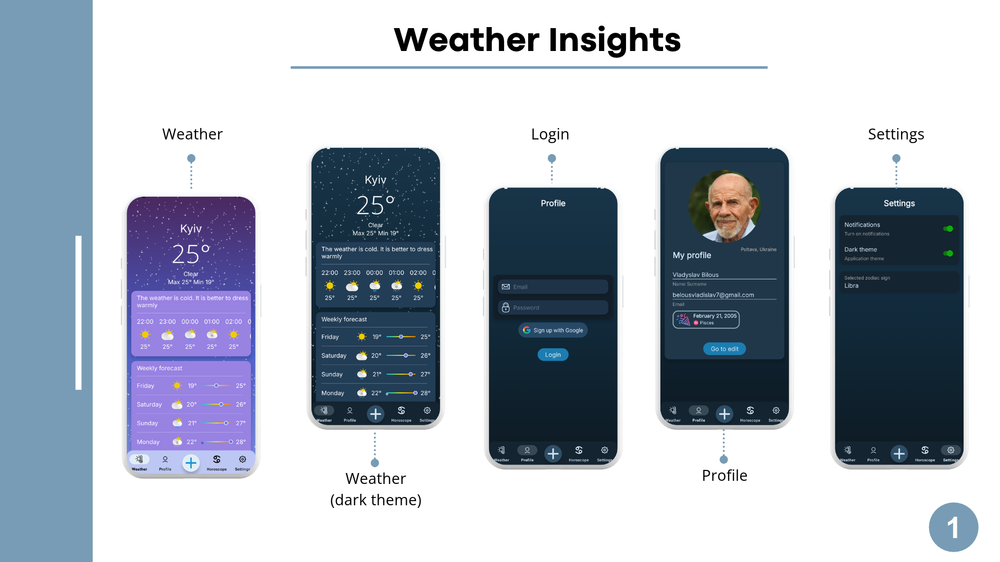
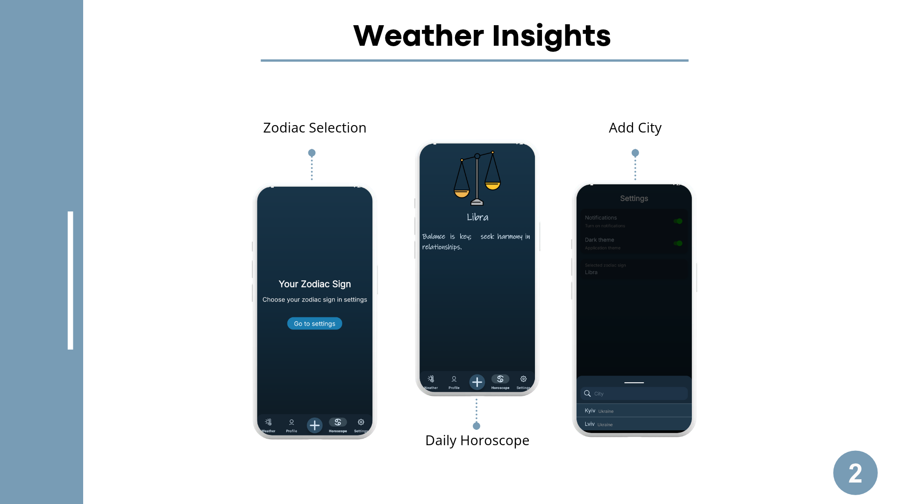

# Weather Insights — Weather Forecast Mobile App

A mobile application for tracking weather in multiple cities with hourly and weekly forecasts, personal profile, daily horoscope, and customizable settings.

## Main Features

- Current weather, hourly and weekly forecasts for multiple cities
- Add and manage cities
- User authentication (email/password + Google Sign-In)
- User profile with personal information
- Daily horoscope based on selected zodiac sign
- Settings:
  - Notifications
  - Dark / Light theme
  - Zodiac sign selection
- Bottom navigation (Weather, Profile, Horoscope, Settings)

## Technologies

- Kotlin
- Android SDK
- Retrofit + Gson
- OkHttp Logging Interceptor
- Firebase (Authentication, Cloud Messaging)
- Google Play Services Auth

## Screenshots

## Author

Vladyslav Bilous  
Kharkiv National University of Radio Electronics  
Specialty 121 — Software Engineering
